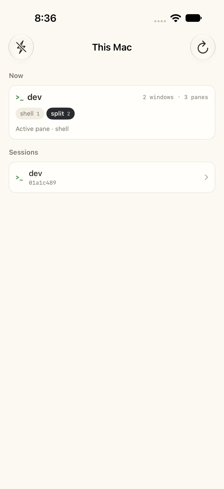
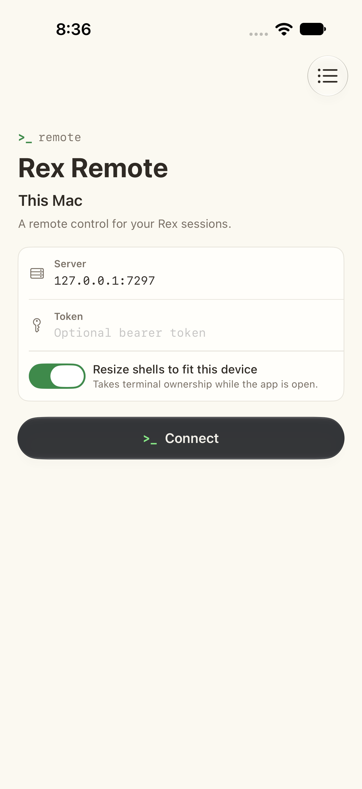
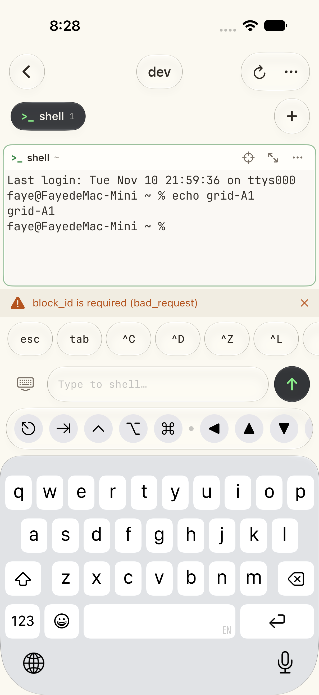
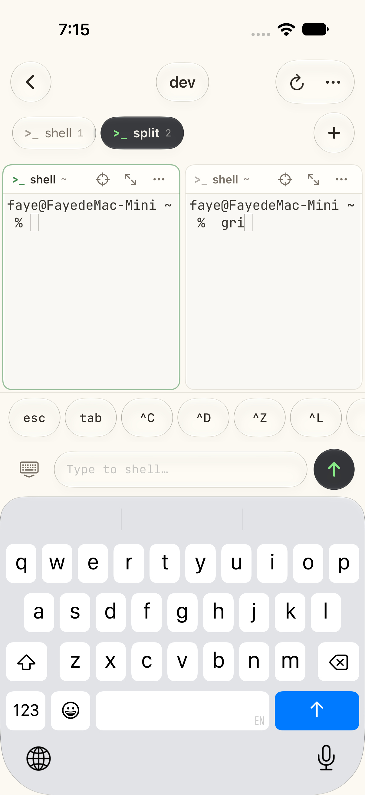
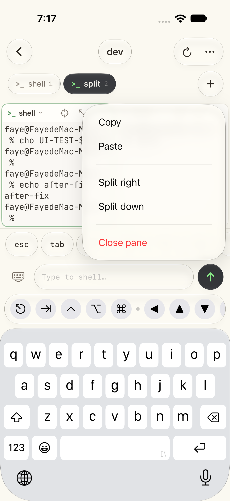
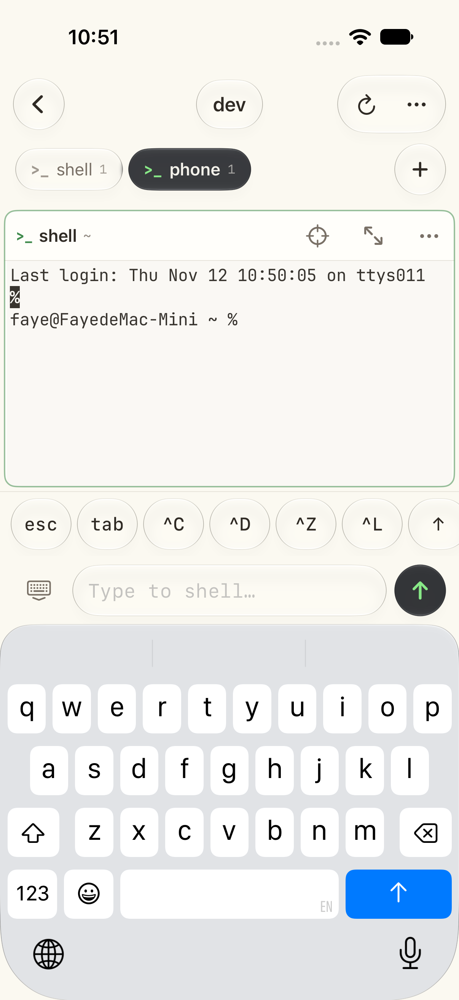
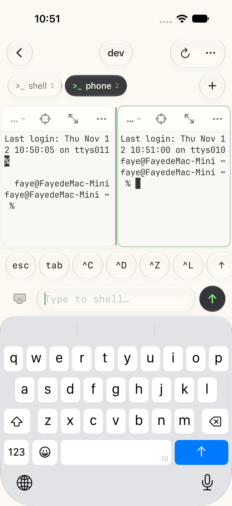
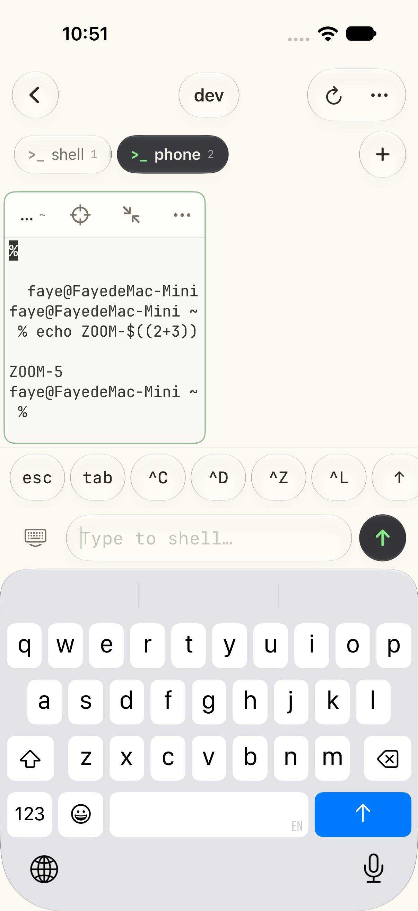

# Rex Remote

An iOS client for a [Rex](https://www.superlogical.com/rex/docs/automate/server-api) server: connect to a Mac over the
Rex Server API, browse sessions and windows, and drive the panes from the phone.

[](https://github.com/eaglu/RexRemote/actions/workflows/ci.yml)



## What it does

- **Hosts** — remembers several servers (`host:port`, optional Bearer token), defaults to `127.0.0.1:7297`.
- **Sessions** — `session.bootstrap` gives the session list plus the active window's layout in one round trip.
- **Windows** — tab chips per window with pane counts, live `session_view_changed` updates, new window from the
  toolbar; long-press a chip to rename or close that window. The phone follows the server whenever another client
  changes the active window.
- **Panes** — the layout tree's fractional rects are rendered positionally, so tiled splits look like the Mac's.
  Focus ring follows `session.focus_block`. Dragging the border between two panes sends `session.resize_pane` with
  the ratio the layout tree reports, so the Mac's split really moves.
- **Pane menu** — copy/paste, rename, copy working directory, clear scrollback, reset, zoom (`session.zoom_block`),
  float (`session.float_block`), swap with another pane, move beside another pane, move to another window, split
  right/down, new pane beside, read the Mac's clipboard, close.
- **Terminal** — each pane owns a `data.connect` ticket, a `rex.data.terminal.v1` socket, and a libghostty surface
  from `GhosttyTerminal`'s in-memory backend. A `terminal.format` `vt` dump primes the screen, then live bytes
  stream in (Ghostty snapshot skipped, APC `resize`/`theme` directives applied). libghostty draws with Metal, so
  selection, links, mouse reporting and kitty graphics come from Ghostty itself; typed input goes out through
  `terminal.write` after an 8 ms coalescer keeps the order intact.
- **Navigation** — the session menu can move focus by direction, step through panes or windows, focus a specific
  window, create a floating layer, and minimise/raise/lower/close floating layers (`session.focus_*`,
  `session.new_layer`, `session.set_layer_state`, `session.raise_layer`, `session.lower_layer`, `session.close_layer`).
- **Session admin** — the session list creates and destroys sessions (`session.create`, `session.close`) and the
  toolbar's info button opens a sheet built on `server.status`, `server.whoami`, `client.list` and `hosts.*`,
  including a reachable-hosts list you can add to or prune.
- **Fit to phone** — with "Resize shells to fit this device" on, the app takes block ownership
  (`session.own_block`) and sends `com.superlogical.terminal.resize` so the pty reflows to the pane.
- **Input** — compose field (sends a line), key row (esc, tab, ^C, ^D, ^Z, ^L, arrows, `| ~ / -`).
- **Zoom** — the pane menu's zoom expands one pane to the whole canvas without touching the Mac's layout.
- **Rex design, light only** — warm paper, warm white cards, a charcoal chip for the active window, one mint accent,
  and Liquid Glass chrome (top bar, window tabs, input dock) floating above the paper. Light is forced at two levels
  (SwiftUI colour scheme and `UIUserInterfaceStyle`) so no screen can fall back to a dark skin.

## Layout of the code

```
RexRemote/RexRemote/
  App/RexRemoteApp.swift        entry point
  Support/WebSocketConnection.swift  Network.framework RFC 6455 client (subprotocol + headers)
  Support/JSON.swift            JSONObject helpers, base64url
  Rex/RexClient.swift           rex.control.v1: hello/welcome, request/response, seq dedupe, reconnect token
  Rex/RexStreamParser.swift     strips `ESC _ rex1;<nonce>;<json> ESC \` directives out of the byte stream
  Rex/RexModels.swift           session view + layout tree → positioned panes
  State/HostStore.swift         persisted hosts
  State/AppStore.swift          session list, attachments, view refresh, block methods
  Terminal/TerminalController.swift  one block's stream: ticket → prime → live, resize, input
  Views/…                       SwiftUI screens
RexRemote/RexRemoteUITests/     end-to-end test against a live server
```

## Build

```sh
brew install xcodegen          # project.yml → RexRemote.xcodeproj
cd RexRemote && xcodegen generate
open RexRemote.xcodeproj       # or:
xcodebuild -project RexRemote.xcodeproj -scheme RexRemote \
  -destination 'platform=iOS Simulator,name=iPhone 18 Pro' \
  -skipPackagePluginValidation build
```

`-skipPackagePluginValidation` is needed because the pinned dependencies ship build-tool plugins that Xcode would
otherwise ask you to trust interactively.

Requires iOS 18+, Xcode 26+ (Swift 6 toolchain, Swift 5 language mode).

## Run against a server

The Mac's default server listens on a unix socket (`~/Library/Application Support/rex/server.sock`), which the phone
cannot reach. Expose it over TCP:

```sh
rex server run --extra-listen http://0.0.0.0:7297 --allow-anonymous
```

For a throwaway sandbox (what the UI test uses):

```sh
rex server run --listen unix:///tmp/rextest/server.sock \
  --extra-listen http://127.0.0.1:7297 --allow-anonymous \
  --state-dir /tmp/rextest/state
```

Then enter `<mac-ip>:7297` in the app. Sessions created on the Mac appear in the list; the "Now" card at the top
shows the current window's panes.

## Remote access from anywhere

Rex's TCP listeners have **no password**: `rex server run` only offers `--allow-anonymous`, so a port opened to the
internet is a shell for whoever finds it. Put an authenticating proxy in front instead. A Cloudflare Tunnel keeps
rex on loopback and lets Cloudflare Access hold the door:

```sh
# 1. rex stays local; the tunnel is the only way in
rex server run --extra-listen http://127.0.0.1:7298 --allow-anonymous

# 2. once the Access application exists for the hostname
cloudflared tunnel --config ~/.cloudflared/config-rex.yml run rex
```

```yaml
# ~/.cloudflared/config-rex.yml
tunnel: <tunnel-uuid>
credentials-file: /Users/<you>/.cloudflared/<tunnel-uuid>.json
protocol: http2
ingress:
  - hostname: rex.example.com
    service: http://127.0.0.1:7298
  - service: http_status:404
```

Create a **self-hosted** Access application for that hostname with a *Service Auth* policy (no browser login),
make a Service Token, and paste its Client ID/Secret into the app's **Cloudflare Access** section. The app sends
`CF-Access-Client-Id` / `CF-Access-Client-Secret` on every WebSocket handshake, and pings the control socket
every 45s so Cloudflare does not drop the idle connection.

Bare public hostnames default to `https`/`wss`; anything with an explicit port, `localhost`, `*.local`, or a bare
IP stays on `http`.

## Test

```sh
cd RexRemote
xcodebuild -project RexRemote.xcodeproj -scheme RexRemote \
  -destination 'platform=iOS Simulator,name=iPhone 18 Pro' \
  -skipPackagePluginValidation test
```

`RexRemoteUITests` launches the app with `-rexHost 127.0.0.1:7297` (override with `REX_TEST_SERVER`), connects, opens
the demo session, types `echo UI-TEST-$((6*7))` into the compose field (asserting the field kept every keystroke), taps
a key from the key row, then creates a window, splits it, zooms a pane, types again, and closes the window through the
tab's context menu — so the server is left exactly as it was found. Screenshots go to the runner's Documents
directory.

## Design notes

**Colour.** `RexTheme` carries the whole palette: paper `#FBF9F1`, card `#FFFEFA`, strip `#F1EDE2`, ink `#2F2A24`,
secondary ink `#797066`, hairline `#E6E3DA`, the charcoal chip `#292B2F` for the active window, mint `#88E987` for
the `>_` glyph, terminal fallbacks `#FAF8F3` / `#38342E` plus a One Light 16-colour palette. The Mac's theme travels
in the byte stream; panes take it when it arrives and only its `resize` hints are acted on.

**Liquid Glass.** Rex on the Mac floats a capsule of tabs and a cluster of glyph buttons above the terminal, and keeps
everything the text sits on opaque. That hierarchy is what the app copies, using the iOS 26 APIs:

| Rex on the Mac | Here |
|---|---|
| capsule holding the window tabs | one glass pill per tab inside a `GlassEffectContainer`, the active tab a dark tinted glass pill that morphs on switch (`glassEffectID`) |
| the tab capsule's trailing `+` | round glass button next to the strip |
| window glyphs in a rounded strip | back, session label, and the three action glyphs as three glass islands |
| floating chrome over content | top bar, tab strip, and input dock are glass; panes, session rows, and every terminal canvas stay solid |
| one loud accent (`>_` glyph) | mint is the only accent colour; glass tints are charcoal or clear, never a second hue |

The rules of thumb: glass only where something floats, never under text, and tint with the same charcoal the Mac
uses rather than a second brand colour. The page itself stays a flat warm paper: an earlier version put two soft
radial washes behind the chrome so the glass would have something to refract, but at usable opacities the effect was
invisible (iOS 26 glass adapts to its surroundings on its own) and only muddied the paper, so it was removed.

**Renderer.** Two things bite when drawing a terminal with Core Text in a UIView: `CTLineDraw` paints with the
*context's* fill colour (not the attributed string's), and UIKit's context is y-down while Core Text is y-up, so
`context.textMatrix` has to be flipped or every glyph is mirrored below its baseline and clipped away. The baseline
itself is derived from the font (`(cellHeight - lineHeight) / 2 + ascender`) rather than from the descender. On the
core side, the row iterator must be re-fetched from the render state after each `ghostty_render_state_update`, and
the palette has to be set before the first byte or the dump is resolved against libghostty's white-on-black default.

**Input.** Typing goes through a hidden `UITextView` instead of `UIKeyInput`, so an IME (pinyin, kana, …) composes
before anything is sent — with `UIKeyInput` every pre-edit letter reached the shell as its own keystroke. Committed text
is cleared from the host view immediately, and a frame's worth of keystrokes is coalesced into one
`com.superlogical.terminal.write`: one request per keystroke let them overtake each other and land out of order.

**App icon.** `RexRemote/Assets.xcassets/AppIcon.appiconset/AppIcon.png` is the official Rex mark (rainbow field, cream
dino, `BETA` pill), taken from `Rex Beta.app/Contents/Resources/App Icon Beta.icns` and upscaled 256 → 1024. No
larger or pill-free original exists — the web set (`rex-icon.png`, `apple-touch-icon`, `favicon`) is also 256 px and the
pill is baked into the artwork — so the icon keeps it verbatim rather than inventing a redrawn mascot. Candidates
that were explored live in `Design/` (`icon-official-web.png`, `icon-official-mac.png`, `dino-*.png` drafts,
`icon-candidates.png` contact sheet).

## Renderer (libghostty)

Panes are drawn by **libghostty** through
[`lakr233/libghostty-spm`](https://github.com/lakr233/libghostty-spm) (MIT,
prebuilt XCFramework, no Zig needed):

- `InMemoryTerminalSession` is the seam — the Rex stream is pushed in with
  `receive(_:)`, and the bytes the terminal produces (typing, key row, paste)
  come back out through the session's `write` handler, coalesced into one
  `terminal.write` RPC every 8 ms.
- The surface is libghostty's own view, so rendering (Metal), wide characters,
  ligatures, cursor shapes, selection and links are Ghostty's rather than ours.
- The palette comes from `RexTheme.ghosttyTheme` at launch and is replaced by the
  `theme` directive the server weaves into the stream.
- Key row presses (esc, tab, ctrl chords, arrows) go through libghostty's key
  encoder instead of hand-written bytes, so arrows turn into SS3 or
  `CSI 1;<mods>` sequences when the application asks for them.
- The pane menu carries **Copy** (the selection libghostty drew) and **Paste**
  (through the surface, so bracketed paste is honoured); hyperlinks opened in the
  grid are handed to `UIApplication.open` by `TerminalSurface.Coordinator`.
- The top bar is a `ZStack`: the session label is centred against the screen and
  the trailing cluster holds only refresh and the overflow menu, because a
  narrower cluster is what actually centres a label between two sides.
- `GhosttySession`, `GhosttyGridView` and their tests are gone with it.

Known edge: a lone `esc` from the key row leaves zle waiting for the rest of a
key sequence (`KEYTIMEOUT`), so the shell eats the next character. That is the
shell's behaviour, not the app's — vim and less rely on it.

## Screens

| | |
|---|---|
|  |  |
|  |  |
|  |  |
|  |  |

## Notes and limits

- Control and data sockets are reopened per pane; resume uses the 16-byte reconnect token carried by the data
  protocol's 32-byte welcome (declared in the code, not yet exercised by a test).
- The data stream is one-way; all input goes through `terminal.write`, so a pane keeps working even if the phone's
  keyboard is hidden.
- Text selection, link opening, and kitty graphics are not implemented in the renderer yet; frames are redrawn
  whole rather than by damage rectangles.
- Scrollback is whatever the server replays; the renderer only shows the visible grid (no local history).

## Continuous integration

`.github/workflows/ci.yml` runs on every push to `main`, on tags, and on pull requests:

1. picks the newest stable Xcode and fails loudly if the iOS SDK is older than 26 (the glass APIs need it),
2. `xcodegen generate`, then the unit suite only — `-only-testing:RexRemoteTests`, because `RexRemoteUITests`
   drives a live Rex server that CI does not have,
3. builds a Release device build with signing disabled and uploads `RexRemote-unsigned.ipa` as a workflow artifact.

Tagged builds (`v*`) are what the releases under [Releases](https://github.com/eaglu/RexRemote/releases) are cut from.
